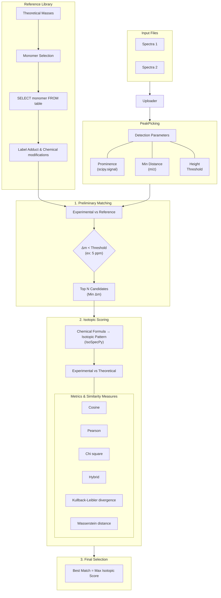

# SugarMALDI

**A Comprehensive MALDI-MS Spectra Analysis Tool for Oligosaccharide Characterization**

SugarMALDI is an open-source computational framework for analyzing high-resolution MALDI mass spectrometry data with a focus on carbohydrate and glycan characterization. It integrates spectral preprocessing, adduct-aware composition inference, isotopic pattern scoring, and interactive visualization tools.

**Key Capabilities:**
- Peak detection on high-resolution spectra
- Batch processisng
- Custom adduct support
- Library matching against theoretical oligosaccharide combinations
- Isotopic pattern scoring (6 similarity metrics)
- Memory-efficient processing with Polars LazyFrames
- Interactive Streamlit interface 

## User-friendly interface  

Access the app via Streamlit:  
***Deployed version:** Not yet available (planned for Q4 2026).*

## Try it on your machine  

### Installation  

#### 1. Clone the repository

```bash
git clone https://github.com/Protactinium92/SugarMALDI.git
cd SugarMALDI
```

#### Option 1 — Installation with uv (recommended 🚀)

##### Install uv (if not already installed)

```bash
pip install uv
```

Or (Linux / Mac):

```bash
curl -Ls https://astral.sh/uv/install.sh | sh
```


> [!NOTE]  
> uv is a fast Python package and project manager that can replace pip, virtualenv, and more.  
> More information on [](https://docs.astral.sh/uv/)  


##### Install the project

```bash
uv sync
```

This will:
- create a virtual environment automatically  
- install all dependencies from `pyproject.toml`  

#### Option 2 — Standard installation (pip + venv)

Create a virtual environment
```bash
python -m venv .venv
```
Activate it

**Linux / Mac:**
```bash
source .venv/bin/activate
```

**Windows:**
```bash
.venv\Scripts\activate
```

Upgrade pip
```bash
pip install --upgrade pip
```

Install the project
```bash
pip install .
```

### Setup the Oligosaccharide Library

> [!IMPORTANT]  
> Before starting your first analysis, you **must** generate the oligosaccharide library by running this command:
>```bash
># UV:
>uv run src/oligoMass.py
># In virtual environnement
>src/oligoMass.py
>```
>This will create a CSV file in `data/` with theoretical masses for all the 10M combinations of the monomers list in `data/monomers.csv`.

### Run the app  

Directly with UV:
```bash
uv run streamlit run app.py
```

Or in virtual environnment:

```bash
streamlit run app.py
```

The app will open at `http://localhost:8501`

## 📁 Project Structure

### **Root Files**

| File | Purpose |
|------|---------|
| `app.py` | **Main Streamlit UI** — orchestrates file uploads, visualization, and analysis pipeline |
| `pyproject.toml` | **Project metadata** — dependencies (managed with `uv`, PEP 517/518 compliant). *Requires Python ≥3.13* |
| `README.md` | This file |
| `USER_GUIDE.md` | Detailed user documentation |
| `LICENSE` | CeCILL 2.1 license |


### **Core Logic (`src/`)**
The backend logic is organized in the `src/` directory, with modules grouped by functionality:

| **File** | **Role** | **Key Functions** |
|----------|----------|------------------|
| `config.py` | Global constants | Paths, adducts, labels, default parameters |
| `spectrum_analysis.py` | **Core pipeline** | Peak detection, matching, scoring engine |
| `oligoMass.py` | Library generation | Theoretical oligosaccharide combinations |
| `load_file.py` | File I/O | CSV reading (Polars LazyFrames) |
| `front_functions.py` | **Frontend-backend bridge** | Functions called directly by `app.py` |
| `plot_spectrum.py` | Visualization | Matplotlib/Plotly spectrum & isotopic plots |
| `helper.py` | Educational UI | Interactive help + parameter explanations |
| `session_manager.py` | Session state | Streamlit state + change detection |
| `utils.py` | Utilities | Formula parsing, validation, adduct processing |
 

>[!NOTE]  
>Dependencies: All core modules rely on polars (for DataFrames), streamlit (UI), and scipy/IsoSpecPy (scientific computations).  
>Performance: Heavy operations (e.g., peak detection) use lazy evaluation (Polars) and caching (@st.cache_data or joblib).

### **Data Files**

| File | Contents |
|------|----------|
| `data/monomers.csv` | Reference monomer list with elemental compositions |
| `data/mass_elements.txt` | NIST monoisotopic mass library |
| `data/oligo_combinations.csv` | **Generated** — theoretical oligosaccharide library (run `oligoMass.py` first) |
| `pictures/` | Logos and assets |


## 🔬 Scientific Workflow

### Simplified Pipeline
```
Input Spectra (CSV)
    ↓
[1] Peak Detection (Prominence, Height, Distance)
    ↓
[2] Preliminary Mass Matching (ΔM threshold)
    ↓
[3] Isotopic Pattern Scoring (6 metrics available)
    ↓
Output: Identified peaks with formulas & scores
```

### **Workflow Overview**



> [!NOTE]  
> **Key Technical Details**
> - **Isotopic Scoring**: Uses [`IsoSpecPy`](https://github.com/MatteoLacki/IsoSpec) to generate **theoretical isotopic patterns** for comparison with experimental data.
> - **Chemical Modifications**: Only **simple additions or losses** (e.g., Na⁺, K⁺, H₂O) are supported in the adduct and modification selection.

> [!IMPORTANT]  
> A **careful monomer selection** is **critical** to ensure:
> - **Performance**: Avoid overly large reference libraries to prevent slow processing.
> - **Reliability**: Incorrect monomer choices may lead to **false positives/negatives** in matching.
>
> For detailed instructions, see the **[User Guide](USER_GUIDE.md)**.


### Analysis Parameters Explained

#### Peak Detection

| Parameter | Unit | Typical Value | Impact |
|-----------|------|---------------|--------|
| **Prominence** | Intensity units | 1e5 | Minimum height difference from baseline |
| **Height Minimum** | Intensity units | 2e5 | Absolute intensity threshold from 0 |
| **Min m/z Distance** | m/z (Da) | 15 | Minimum spacing between peaks |
| **Window Size** | m/z (Da) | 500 | Spectrum segmentation for parallel processing (Cannot be change by the user)|

#### Mass Matching

| Parameter | Unit | Typical Value | Impact |
|-----------|------|---------------|--------|
| **ΔM Threshold** | ppm | 5 | Mass accuracy tolerance (typical MALDI) |
| **Number of Candidates** | count | 4 | Top N masses retained for isotopic scoring |

#### Isotopic Scoring

| Parameter | Unit | Typical Value | Options |
|-----------|------|---------------|---------|
| **Number of Isotopes** | count | 4 | 2-6 (M, M+1, M+2, ...) |
| **Scoring Method** | — | Hybrid | Cosine, Pearson, χ², KL, Wasserstein, Hybrid |

> [!WARNING]  
> **Requirements for Analysis**
> - **All parameters** (peak detection, adducts, chemical modifications, etc.) **must be correctly filled** to enable the analysis button.
> - **Manual Rerun Required**: If **any parameter is modified** (e.g., peak detection settings, adducts, or thresholds), the analysis **must be rerun manually**. Changes are **not applied automatically**.

## 📊 Input / Output Formats

### Input Format (CSV)

**Required columns:** `m/z` and `Intensity`

**Example:**
```csv
m/z,Intensity
500.1234,12500
500.2456,25000
500.3678,18900
...
```

**Supported delimiters:** `,` | `Tab` | `Space` | `;` | `:` | `|` | `-`

### Output Format (ZIP Archive)

The download ZIP contains:

```
results_maldi.zip
├── peak_spectrum_1.csv
└── peak_spectrum_2.csv
```

Each `peak_*.csv` contains:

```csv
m/z,Intensity,Delta_M,Identifications,Formula,iso_score
500.1234,12500,4.2,"Hex2-dHex1","C12H22O11+Na","0.987"
500.2456,25000,3.8,"Hex3","C18H32O16+Na","0.995"
...
```

 ## ⚙️ Advanced Configuration

### Customizing Adducts and Labels

Via the Streamlit UI:

1. **Toggle:** "Use custom adduct and chemical modifications"
2. **Add adducts:** Define name, mass (m/z), and formula
3. **Mark as lost:** Check if the adduct is lost during ionization
4. **Custom labels:** Enable "Use custom label" and enter name + formula

**Example:**
- Name: `Na+`
- Mass: `22.989221`
- Formula: `Na`
- Lost: `False`

### Modifying Monomers Library

Edit `data/monomers.csv` (semicolon-separated):

```csv
Notation;Description;C;H;N;O;S;P
Hex;Hexose;6;12;0;6;0;0
dHex;Deoxyhexose;6;12;0;5;0;0
HexA;Hexuronic acid;6;10;0;7;0;0
...
```

Then regenerate the library:
```bash
uv run src/oligoMass.py
```

## Troubleshooting  

### "No runtime found, using MemoryCacheStorageManager"

The application relies on cached functions distributed across multiple modules. In some execution contexts, Streamlit may display the following warning:

```text id="9l95cl"
WARNING streamlit.runtime.caching.cache_data_api:
No runtime found, using MemoryCacheStorageManager
```

In this case, Streamlit automatically uses an in-memory cache backend. This behavior is expected and does not affect the application.

### Long computation times

**Cause:** Too many monomers selected → exponential growth of combinations

**Solution:**
- Reduce monomer selection to 3-5 likely candidates
    - See [USER_GUIDE.md](USER_GUIDE.md) for composition reference
- Decrease ΔM threshold to reduce the number of theoretical candidates per experimental peak
    - Can missed some peaks
- Process spectra in smaller batches by adjusting `Window Size` (default: 500 Da) **directly in the code** (`session_manager.py`) to split the spectrum into independent segments for multiprocessing

### Missing identifications

**Possible causes:**
1. Peak detection parameters too strict (high prominence/height)
2. ΔM threshold too tight
3. Selected monomers do not match the sample composition

**Solutions:**
- Lower prominence/height thresholds
- Increase ΔM from 5 to 10 ppm
- Rerun with different monomer selections

### File parsing errors

**Issue:** "Could not parse spectrum file"

**Solutions:**
- ✅ Select correct delimiter before uploading
- ✅ Ensure columns are named `m/z` and `Intensity` (case-sensitive)
- ✅ Remove empty rows/columns from CSV

## 📈 Performance Optimization

### Memory Efficiency

- **Polars LazyFrames:** Deferred execution reduces peak memory usage
- **Windowing:** Spectrum divided into ~500 m/z segments for parallel processing
- **Caching:** Results cached via `@st.cache_data` to avoid recomputation

### Speed Optimization

| Optimization | Speedup | Method |
|--------------|---------|--------|
| Reduce monomers | 5-10x | Select only expected monosaccharides |
| Increase ΔM threshold | 2-3x | Less stringent mass filtering |
| Decrease isotope count | 1.5-2x | Use 3-4 isotopes instead of 6 |
| Parallel processing | 4-8x | Automatic via ProcessPoolExecutor |

### Benchmarks (from [USER_GUIDE.md](USER_GUIDE.md))

Execution time for **Arabinogalactan (AG)** and **Galactomannan (GM)**:

| # Monomers | AG (s) | GM (s) |
|:---:|---:|---:|
| 1 | 10 | 38 |
| 3 | 24 | 104 |
| 5 | 75 | 350 |
| 7 | 205 | 490 |


## 📚 Example Data

Example spectra can be downloaded from:  
**[SugarMALDI Google Drive](https://drive.google.com/drive/folders/1_okD6vXmOA4NmZ66R5Os8q0V76rWMidL)**

Contains 4 calibrated/non-calibrated examples:
- ✓ Arabinogalactan standard
- ✓ Galactomannan standard

## Extending SugarMALDI for Other Polymers

Although SugarMALDI was initially developed for the characterization of oligosaccharides in painting gums, its modular algorithmic framework allows adaptation to other hetero-polymers.

### 1. Adding New Monomers

SugarMALDI relies on the `monomers.csv` file to define the reference monomer library.  
The software can be adapted to new polymer classes by updating this file.

The `monomers.csv` file must follow this format using a semicolon (`;`) separator:

| Column | Description |
|---|---|
| `Notation` | Short name used to identify the monomer |
| `Description` | Brief definition of the monomer |
| `C`, `H`, `O`, `N` | Atomic count of each element in the individual (non-polymerized) monomer |

Example:

```csv
Notation;Description;C;H;O;N
dHex;Deoxyhexose;6;12;5;0
Hex;Hexose;6;12;6;0
...
```

### 2. Customizing Polymerization Chemistry

While the monomer library can be easily configured, the polymerization reaction logic is currently implemented directly in the source code.

By default, SugarMALDI assumes that polymer formation occurs through a condensation reaction, where each linkage between two monomers results in the loss of one water molecule (H₂O). Therefore, for a polymer composed of *n* units involved in condensation, a mass correction corresponding to the loss of (*n* − 1) H₂O molecules is applied.

If your target polymer involves a different chemical reaction (e.g., loss of another molecule, different stoichiometry, or no condensation step), the corresponding functions must be adapted:

- `oligoMass.py`
  - `calc_oligo_mass`: calculates the polymer mass based on monomer composition and applies the mass correction associated with the condensation reaction.
  - `add_adduct_columns`: applies mass modifications introduced by adducts, chemical modifications, and labeling groups. When a label is introduced through a condensation reaction, it is included as an additional condensation unit and contributes to the corresponding H₂O loss correction.

- `spectrum_analysis.py`
  - `calculate_brut_formula`: defines the elemental composition corrections applied during molecular formula generation.

These functions determine how polymerization, labeling, chemical modifications, and adducts are reflected in the calculated molecular mass and elemental composition.

### 3. Known Limitations: Protein Analysis

Although SugarMALDI could theoretically be extended to protein analysis, the current implementation has an important limitation:

**Combinatorial complexity**  

The algorithm relies on the generation of a reference library containing possible polymer compositions. For a polymer composed of up to L monomer units from a set of N possible monomers, the number of possible sequences/combinations can grow exponentially with polymer length, with an approximate complexity of $O(N^L)$

For example, considering the 20 standard amino acids and a peptide length of 24 residues, the theoretical search space could reach: $20^{24}\approx 1.7 \times 10^{31}$ possible combinations.

This combinatorial explosion dramatically increases both the size of the generated reference library and the number of molecular masses that must be evaluated during the search step. Consequently, the current version of SugarMALDI is designed for small-to-medium-sized oligosaccharides and is not computationally suitable for the analysis of large polypeptides without additional optimization strategies

## 🔧 Dependencies

| Package | Version | Role |
|---------|---------|------|
| `streamlit` | ≥1.49.1 | Interactive UI framework |
| `polars` | ≥1.33.0 | Data processing (LazyFrames) |
| `isospecpy` | ≥2.3.5 | Isotopic pattern generation |
| `scipy` | ≥1.16.1 | Peak detection (find_peaks) |
| `numpy` | ≥2.3.2 | Numerical operations |
| `matplotlib` | ≥3.10.6 | Static spectrum rendering |
| `plotly` | ≥6.3.0 | Interactive visualization |
| `joblib` | ≥1.5.3 | Parallel processing caching |

See `pyproject.toml` for complete dependency list.

## 📜 License

SugarMALDI is distributed under the **CeCILL 2.1 License**.

The full license text is available in the LICENSE file and at
https://cecill.info.

## Citation

If you use SugarMALDI in your research, please cite it as follows:

```bibtex
@software{SugarMALDI,
  author = {HO, Pierre-Alexandre and Rolando, Christian and Yammine, Marie},
  title = {SugarMALDI: An Application for oligosaccharides’ identification in MALDI-MS data.},
  year = {2026},
  doi = {10.5281/zenodo.TBD},
  url = {https://github.com/Protactinium92/SugarMALDI},
  license = {CeCILL-2.1},
  keywords = {mass spectrometry, MALDI, glycomics, carbohydrates, bioinformatics}
}
```

## Contributing  

Contributions are welcome! Please:

1. **Report bugs** via GitHub Issues
2. **Suggest features** with detailed use cases