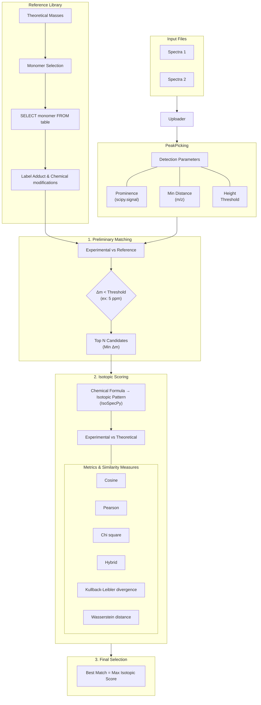

# SugarMALDI v0.1.5

A Spectra Analysis Tool


## User-friendly interface  

Access the app via Streamlit:  
*(add deployed link here if available)*

## Try it on your machine  

### Installation  

#### 1. Get the code  

```bash
git clone https://github.com/Protactinium92/SugarMALDI.git
cd SugarMALDI
```

#### Option 1 — Installation with uv (recommended 🚀)

##### Install uv (if not already installed)

```bash
pip install uv
```

Or (Linux / Mac):

```bash
curl -Ls https://astral.sh/uv/install.sh | sh
```


> [!NOTE]  
> uv is a fast Python package and project manager that can replace pip, virtualenv, and more.  
> More information on [](https://docs.astral.sh/uv/)  


##### Install the project

```bash
uv sync
```

This will:
- create a virtual environment automatically  
- install all dependencies from `pyproject.toml`  

#### Option 2 — Standard installation (pip + venv)

Create a virtual environment
```bash
python -m venv .venv
```
Activate it

1. Linux / Mac
```bash
source .venv/bin/activate
```

2. Windows
```bash
.venv\Scripts\activate
```

Upgrade pip
```bash
pip install --upgrade pip
```

Install the project
```bash
pip install .
```

### Run the app  

Directly with UV:
```bash
uv run streamlit run app.py
```

Or in virtual environnment:

```bash
streamlit run app.py
```

> [!IMPORTANT]  
>Before starting the first analysis please create the oligosacaride library by running this command:
>```bash
># UV:
>uv run src/oligoMass.py
># In virtual envioronnement
>src/oligoMass.py
>```
>This will create a CSV file in `data/` with theoretical masses for all the 10M combinaison of the monomers list in `data/monomers.csv`.

## 📁 Project Structure

### **Root Files**
- `pyproject.toml` → Project metadata and dependencies (managed with [`uv`](https://github.com/astral-sh/uv), PEP 517/518 compliant).
  *Recommended Python version: **≥ 3.9***.
- `app.py` → Main Streamlit UI (orchestrates file uploads, visualization, and backend calls).

### **Core Logic (`src/`)**
The backend logic is organized in the `src/` directory, with modules grouped by functionality:
   **File**               | **Role**                                                                                     |
 |------------------------|---------------------------------------------------------------------------------------------|
 | `config.py`            | Global constants (e.g., Default label and adduct formula, file paths, default parameters).              |
 | `spectrum_analysis.py`| **Core pipeline**: Peak detection, spectrum parsing, and matching.               |
 | `oligoMass.py`         | Oligosaccharide mass calculations.                                  |
 | `load_file.py`         | File I/O utilities (CSV, lazy loading with Polars).                         |
 | `helper.py`            | Functions to generate Streamlit markdown/HTML components.                 |
 | `utils.py`             | Low-level functions (e.g. Chemical formula parsing, input validation).                     |
 | `plot_spectrum.py`     | Visualization logic (Matplotlib/Plotly wrappers for spectra and isotopic patterns).         |
 | `session_manager.py`   | Streamlit session state management (caching, progress tracking).                          |
 | `front_fonction.py`    | **Frontend-backend bridge**: Functions called directly by `app.py`. |

>[!NOTE]  
>Dependencies: All core modules rely on polars (for DataFrames), streamlit (UI), and scipy/IsoSpecPy (scientific computations).  
>Performance: Heavy operations (e.g., peak detection) use lazy evaluation (Polars) and caching (@st.cache_data or joblib).


### **Workflow Overview**



> [!NOTE]  
> **Key Technical Details**
> - **Preliminary Matching**: Filters candidates using a **Δm threshold** (typical for MALDI: **5 ppm**).
> - **Isotopic Scoring**: Uses [`IsoSpecPy`](https://https://matteolacki.github.io/IsoSpec/) to generate **theoretical isotopic patterns** for comparison with experimental data.
> - **Chemical Modifications**: Only **simple additions or losses** (e.g., Na⁺, K⁺, H₂O) are supported in the adduct and modification selection.


> [!WARNING]  
> **Requirements for Analysis**
> - **All parameters** (peak detection, adducts, chemical modifications, etc.) **must be correctly filled** to enable the analysis button.
> - **Manual Rerun Required**: If **any parameter is modified** (e.g., peak detection settings, adducts, or thresholds), the analysis **must be rerun manually**. Changes are **not applied automatically**.

> [!IMPORTANT]  
> A **careful monomer selection** is **critical** to ensure:
> - **Performance**: Avoid overly large reference libraries to prevent slow processing.
> - **Reliability**: Incorrect monomer choices may lead to **false positives/negatives** in matching.
>
> For detailed instructions, see the **[User Guide](https://github.com/Protactinium92/SugarMALDI/USER_GUIDE.md)**.

## Example

Example spectra can be downloaded from the dedicated Google Drive folder [here](https://drive.google.com/drive/folders/1_okD6vXmOA4NmZ66R5Os8q0V76rWMidL) 

It contains 4 examples:  
- Arabinogalactan standard: Non-calibrated / Calibrated
- Galactomannan standard: Non-calibrated / Calibrated

Format: CSV, tsv, txt files with m/z and Intensity columns.

## Notes  

The application relies on cached functions distributed across multiple modules. In some execution contexts, Streamlit may display the following warning:

```text id="9l95cl"
WARNING streamlit.runtime.caching.cache_data_api:
No runtime found, using MemoryCacheStorageManager
```

In this case, Streamlit automatically uses an in-memory cache backend. This behavior is expected and does not affect the application.


# License

SugarMALDI is distributed under the CeCILL 2.1 License.

The full license text is available in the LICENSE file and at
https://cecill.info.


## Contributing  

Feel free to open issues to improve the project 🚀  